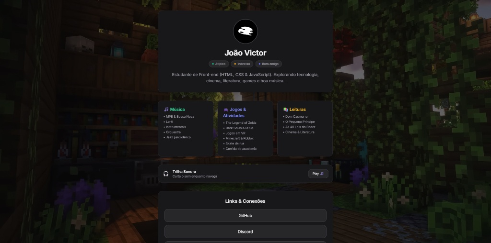

# 🌐 Quem Sou Eu — Portfólio Pessoal

> Uma aplicação web interativa e responsiva desenvolvida para apresentar minha trajetória, projetos e habilidades como desenvolvedor Front-End.

---

## 🛠️ Tecnologias Utilizadas

- **HTML5**: Estruturação semântica e acessível.
- **CSS3**: Estilização moderna, layouts com Flexbox/Grid e design responsivo.
- **JavaScript**: Interatividade da página e manipulação do DOM.
- **Git & GitHub**: Versionamento e hospedagem do código.

---

## ✨ Destaques do Projeto

- 👤 **Seção "Quem Sou Eu"**: Apresentação pessoal detalhando minha evolução técnica.
- 📱 **Design Responsivo**: Adaptado para telas de celular, tablet e computador.
- ⚡ **Interatividade**: Navegação fluida e navegação por seções.

---

## 📸 Prévia

---

## 🔗 Acesse o Projeto

Veja o projeto rodando ao vivo:  
👉 [Clique aqui para visualizar o Portfólio](https://hanzvoegelin-png.github.io/quem-sou-eu/)

---

## 👤 Autor

Desenvolvido por **João Victor** 👋  
- GitHub: [@hanzvoegelin-png](https://github.com/hanzvoegelin-png)
